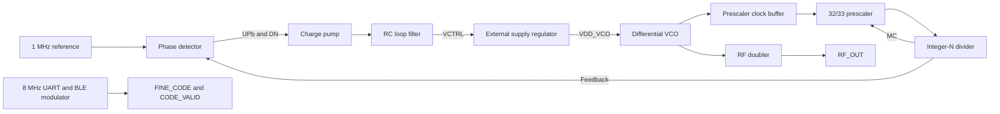

# BLE transmitter integration

`A01_topcell` combines the existing differential VCO and RF doubler, 32/33 prescaler, integer-N divider, phase detector, charge pump, and BLE UART/modulator. The top level adds the routed RC loop filter. It uses the six-metal GF180MCU E stack. The existing macros retain their masks and orientation.

| File | Contents |
| --- | --- |
| [gds/A01_topcell.gds](gds/A01_topcell.gds) | Integrated layout with labeled ports |
| [gds/assembly.json](gds/assembly.json) | Macro locations, pin coordinates and source GDS hashes |
| [schematics/A01_topcell.sch](schematics/A01_topcell.sch) | Xschem assembly sheet. Open it from `build/schematics` |
| [spice/A01_topcell.spice](spice/A01_topcell.spice) and [spice/blocks_pex.spice](spice/blocks_pex.spice) | Simulation top, analog block PEX, routed digital cell netlists and RC device models |
| [lvs_config.json](lvs_config.json) and [spice/A01_topcell_lvs.spice](spice/A01_topcell_lvs.spice) | LVS configuration and source. Set `UPRJ_ROOT` to the directory containing `build` |
| [rtl/A01_digital.v](rtl/A01_digital.v) | Digital assembly using the existing [BLE UART/modulator RTL](../digital/rtl) and [divider RTL](../PLL/analog/integer_n_divider/ble_feedback_divider.v) |
| [verification](verification) | Layout, timing and simulation reports |

## Clock and control connections



The 1 MHz reference and ×2 doubler give `N = 1184 + CFG` and `f_RF = 2 × N × 1 MHz`. Codes 17 through 56 cover 2.402 through 2.480 GHz in 2 MHz steps. Codes 17, 29 and 56 select the three primary advertising frequencies. Set `CFG` while `RST_N` is low and hold it steady in operation.

The filter uses a nominal **41.3 kΩ** unsalicided poly resistor in series with a **143.8 pF** MIM bank to ground. A **1.29 pF** MIM capacitor bypasses `VCTRL` to ground. The pump programs `VCTRL`, and the regulator sources the VCO core current. The buffered feedback stage remains on the fixed `VDD` rail. The extracted VCO sweep and closed-loop model put the useful `VDD_VCO` range near 2.74–2.84 V, with core current on the order of 1.2 mA.

| Port | Connection |
| --- | --- |
| `VDD`, `VSS` | 3.3 V main supply and common ground |
| `VCTRL`, `VDD_VCO` | High-impedance regulator control input and regulator output returning to the VCO core |
| `CP_IBIAS`, `TAIL_BIAS`, `VTUNE` | Inject a nominal 20 µA into `CP_IBIAS`. Start with 1.4 V tail bias and 1.5 V tuning bias in simulation |
| `REF_1M`, `CLK_8M`, `UART_RX` | 1 MHz PLL reference, 8 MHz digital clock and 1 Mbaud UART input |
| `RST_N`, `CFG[5:0]` | Common active-low digital reset and static frequency word |
| `RF_OUT` | Doubled VCO output |
| `FINE_CODE[7:0]`, `CODE_VALID` | Signed digital modulation word and valid strobe for the DAC interface |
| `AIR_BIT`, `SYM_STROBE` | Modulator observability outputs |

The regulator model uses 0.2 V/V control gain, a 2.80 V output at 1.65 V control, and a 75 kHz pole. The gain and offset keep the charge pump near midrail. This is a simulation model with an ideal output stage. The build requires an external regulator implementing the control path. [Regulator SPICE model](spice/vco_supply_model.spice)

## Verification

- KLayout GF180MCU E main and antenna DRC passed. Density checks are reserved for chip integration.
- Metal connectivity matched all 36 nets across 29 top-level pins and 73 macro terminals. Magic and Netgen matched the routed macro boundaries and natively extracted filter. The six existing macro interiors are abstracted in this run.
- At a 25 ns prescaler-output clock period, routed divider timing had at least +0.89 ns setup slack and +0.23 ns hold slack across the 3.3 V library corners. The check includes a 6 ns modulus-control budget and a 30 fF interface load assumption.
- The extracted prescaler produced 1 MHz feedback at both band edges with the counter timing model. The digital divider RTL also passed all 64 settings and four reset/reprogramming cases with a 1.25 GHz prescaler input model.
- In the nominal loop model, the extracted phase detector, charge pump and filter device models settled at both band edges from a midscale control voltage. Worst final-window feedback period error was about 7 ppm and the modeled VCO supply ripple was 0.23–0.24 mV peak-to-peak. The loop test uses a fitted VCO transfer curve and behavioral divider and regulator.
- The assembled SPICE hierarchy converged at a nominal operating point with `VCTRL` held at 1.65 V. The modeled regulator supplied 1.10 mA to the VCO core at 2.80 V.

Remaining hardware integration includes the regulator, DAC, RF output stage, pad ring and metal fill. Full-layout transistor-level lock with top-level parasitics and RF emissions remain to be verified.

## Rebuild and rerun

From the repository root, use a Python environment with `klayout` and `numpy`, an installed GF180 open PDK, ngspice with XSPICE support, Magic, Netgen, OpenSTA and Icarus Verilog.

```sh
export PDK_ROOT=/foss/pdks
export UPRJ_ROOT="$PWD"
python build/generate_netlists.py
python build/generate_schematic.py
python build/assemble_layout.py
python build/verify_lvs.py --out build/runs/lvs
python build/verify_behavior.py --out build/runs/behavior
python build/verify_top_spice.py --out build/runs/top_spice
sta -exit build/check_divider_timing.tcl
iverilog -g2012 -s A01_digital -o /tmp/a01_digital \
  build/rtl/A01_digital.v digital/rtl/*.v \
  PLL/analog/integer_n_divider/ble_feedback_divider.v
python "$PDK_ROOT/gf180mcuD/libs.tech/klayout/tech/drc/run_drc.py" \
  --path="$PWD/build/gds/A01_topcell.gds" --variant=E --run_mode=deep \
  --topcell=A01_topcell --run_dir="$PWD/build/runs/drc" --antenna
```

The six-metal Magic extraction file and its provenance are in [tech](tech). The native LVS script reads `lvs_config.json`, checks actual GDS port connectivity and runs Netgen with the installed GF180 setup. Run each simulation or extraction into a fresh output directory.
